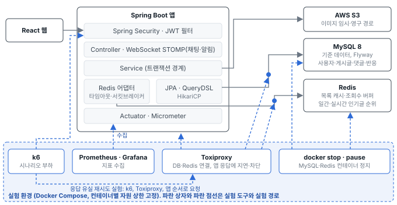

# HighTeenDay Backend

[](https://github.com/JangHyeok2909/highteenday-backend/actions/workflows/ci.yml)
[부하 실험 대시보드](https://janghyeok2909.github.io/highteenday-backend/)

고등학생 익명 커뮤니티의 Spring Boot API 서버다. 이 서버에 부하와 장애(MySQL·Redis 정지와 지연, 응답
유실)를 직접 넣어 문제를 찾고, 고친 뒤 같은 조건으로 다시 재서 확인한 기록을 함께 둔다.

> 2025.05 ~ 2025.08 동아리 팀(백엔드 3명, 프론트엔드 4명)으로 개발했고, 2025.09부터 한 명이 유지보수한다.
> 팀 기간에는 게시글·댓글·인기글·S3 파일 업로드를 맡았고, 2025.09 이후의 백엔드 전반과 부하·장애 실험,
> 그 수정은 혼자 했다. AWS 배포는 비용 문제로 운영을 중단했고, 아래 수치는 모두 Docker 로컬 환경과 생성 데이터에서
> 잰 값이다.

## 핵심 결과

| 문제 | 변경 | 결과 | 사례 |
|---|---|---|---|
| 댓글 목록 N+1 | 반응 일괄 조회, 작성자 fetch join | 요청당 평균 쿼리 1,507개에서 3.9개 (단계마다 같은 조건 5회 실행의 평균). 이 API는 페이지 없이 게시글의 댓글 전체를 반환 | [comment-query-amplification](performance/cases/comment-query-amplification.md) |
| Redis 정지 시 Redis를 쓰지 않는 API까지 실패. 명령 타임아웃 미지정으로 Lettuce 기본값 60초 적용 | Redis 명령 타임아웃 100ms | 장애 구간 p95 60,003ms에서 224ms, 오류율 31.75%에서 0% | [redis-failure-cascade](performance/cases/redis-failure-cascade.md) |
| MySQL 정지·무응답 시 요청 대기 | 커넥션 획득·연결·소켓·쿼리 타임아웃 | 장애 구간 p95 hang 51.3초에서 5.0초, crash 52.1초에서 1.0초. 긴 대기가 빠른 503으로 바뀜(장애 중 성공 응답은 hang 167건에서 1건, crash 121건에서 3건으로 줄었음. crash 변경 후 이미지는 다른 수정 포함) | [mysql-unavailable-wait-bound](performance/cases/mysql-unavailable-wait-bound.md) |
| 응답 유실 뒤 재시도로 좋아요가 꺼짐 | 토글 POST를 PUT·DELETE로 전환 | 게시글·댓글 좋아요 재시도 23건 결함 0건. 스크랩·생성·토큰 재발급은 결함 남음 | [retry-after-lost-response](performance/cases/retry-after-lost-response.md) |

## 읽는 순서

1. [사례 색인](performance/cases/README.md): 실험에서 찾은 문제와 해결 상태
2. [설계 결정](docs/decisions.md): 왜 이렇게 만들었고 무엇을 대가로 냈는가
3. [시스템 구조](docs/architecture.md): 데이터를 어디에 두고, 장애 때 어떻게 동작하는가
4. [측정 방법](performance/METHOD.md): 결과를 믿을 수 있게 비교 조건을 고정한 방법

## 구조



MySQL이 데이터의 기준 저장소이고, Redis는 목록 캐시, DB 반영 전 조회수, 인기글 순위를 둔다. Redis 호출은
명령 타임아웃과 서킷브레이커로 감싸 Redis 장애 때 예외 대신 기본값을 돌려준다. 회색 실선은 운영 경로,
파란 상자와 파란 점선은 실험 도구와 실험 경로다. Toxiproxy는 실험할 때만 앱과 MySQL·Redis 사이에 들어가고,
응답 유실 재시도 실험에서는 k6와 앱 사이에도 들어간다.

## 실험 방법

| 항목 | 방법 |
|---|---|
| 부하 | k6 시나리오. medium 데이터셋은 사용자 1,000명, 게시글 10,000건, 댓글 40,000건, 반응 100,000건 |
| 장애 | Toxiproxy로 MySQL·Redis 지연과 응답 차단, `docker stop`·`docker pause`로 프로세스 정지, 응답만 끊는 재시도 실험 |
| 자원 | 컨테이너마다 CPU·메모리 상한 고정. 값은 [Compose 파일](performance/environment/docker-compose.perf.yml) |
| 비교 | 앱 이미지, 데이터셋 지문, 부하 모델, 측정 구간, 자원 한계가 같은 실행끼리만 비교 |
| 기록 | 실행마다 `run.json` 원자료를 남기고, 문제는 사례 문서로 정리 |

자세한 규칙은 [측정 방법](performance/METHOD.md), 실행 명령과 장애 종류는
[성능·장애 실험](performance/README.md)에 있다.

## 저장소 지도

| 경로 | 내용 |
|---|---|
| `src/main/java/.../highteenday_backend` | 애플리케이션 코드. 패키지 역할은 [시스템 구조](docs/architecture.md) |
| `src/main/resources/db/migration` | Flyway 마이그레이션. 절차는 [DB 마이그레이션](docs/MIGRATION.md) |
| `src/test` | 단위·통합 테스트. CI에서 `./gradlew test` 실행 |
| `docs/` | 시스템 구조, 설계 결정, 알려진 문제, 운영 절차 |
| `performance/` | 부하 시나리오, 장애 주입, 실행 원자료, 사례 문서 |
| `packages/perf-engine` | 측정 도구 CLI (개발 중) |
| `CLAUDE.md` | 코드 구조·트랜잭션·테스트·커밋 규칙. 사람과 AI 코딩 에이전트가 같은 규칙으로 작업 |

## 실행과 확인

목적에 따라 실행 방법이 다르다.

### 테스트

테스트는 H2 메모리 DB를 쓰므로 MySQL과 Redis 없이 돈다. CI도 같은 명령을 실행한다.

```bash
./gradlew test
```

### 앱 실행과 상태 확인: 실험 환경 스택

새로 클론한 저장소에서 앱을 띄워 보려면 성능 실험 환경을 쓴다. `bootstrap.js`가 게시판 기본 행 삽입까지
처리하므로 빈 DB에서 바로 뜬다. 앱은 `prod,perf` 프로필로 `localhost:18080`에 열리고, perf 프로필이 인증
쿠키를 localhost HTTP에 맞게 바꾸므로 로그인한 뒤의 요청도 동작한다. Node.js 18 이상과 Docker Compose가 필요하다.

```bash
cd performance
cp environment/.env.perf.example environment/.env.perf
openssl rand -base64 64 | tr -d '\n'   # 출력값을 .env.perf의 JWT_KEY에 넣는다
docker compose -f environment/docker-compose.perf.yml --env-file environment/.env.perf up -d --build
node environment/bootstrap.js --profile small
curl localhost:18080/actuator/health/readiness
npm test                                  # 측정 도구 테스트
```

부하·장애 실험 실행은 [성능·장애 실험](performance/README.md)을 따른다.

### 루트 Compose: 배포 이미지 기동 확인

`docker compose up -d --build`는 배포 이미지와 같은 prod 프로필로 MySQL, Redis, 앱(8080 포트)을 띄운다.
prod 프로필은 Actuator를 관리 포트 8081에 여는데 Compose는 이 포트를 호스트에 열지 않는다. 인증 쿠키는
`.highteenday.org` 도메인과 Secure 속성으로 나가므로 localhost HTTP에서는 로그인 뒤의 요청이 401이 된다.
이미지가 빌드되고 기동하는지 확인하는 용도로만 쓴다.

### dev 프로필: 이미 데이터가 있는 DB

dev 프로필은 기동 직후 학교, 데모 사용자·게시글, 급식 데이터를 적재한다. 빈 DB에서는 게시판 행이 없어
데모 게시글 적재가 실패하고 앱이 종료되므로, 게시판 행이 있는 DB에서 쓴다. readiness는 이 초기 적재가
끝난 뒤 UP이 된다. 루트 Compose로 앱을 띄웠다면 8080 포트를 비우기 위해 먼저 앱 컨테이너를 멈춘다.
`bootRun`은 터미널을 점유하므로 `curl`은 다른 터미널에서 실행한다.

```bash
docker compose stop app
docker compose up -d mysql redis
DB_PASSWORD=root ./gradlew bootRun --args='--spring.profiles.active=dev'

# 다른 터미널에서
curl localhost:8081/actuator/health/readiness
```

비밀번호 `root`는 루트 Compose MySQL의 기본값이다. `.env`에서 바꿨다면 그 값을 쓴다.

## 알려진 문제

해결하지 못한 문제는 [알려진 문제](docs/issues.md)에서 관리한다. 대표적으로 다음이 남아 있다.

- Redis 장애 중 DB 커넥션 점유가 늘어 커넥션 풀이 가득 찰 수 있다. 원인 조사 중이다(RES-001).
- 스크랩 재시도 시 상태 되돌림, 게시글·댓글·단체 채팅방 생성 재시도 시 중복, 토큰 재발급 재시도 시
  로그아웃.
- 서킷이 열린 동안 조회수 정산이 거절돼 같은 증가분이 다시 반영될 수 있는 문제(DATA-002).
- 만료된 토큰과 서명이 틀린 토큰이 같은 401로 끝나는 문제(AUTH-001).

## 기술 스택

Java 17, Spring Boot 3.4.5, Spring Security, JPA, QueryDSL, MySQL 8, Flyway, Redis, Resilience4j, JWT, OAuth2,
WebSocket/STOMP, AWS S3. 실험 도구는 k6, Toxiproxy, Prometheus, Grafana.
